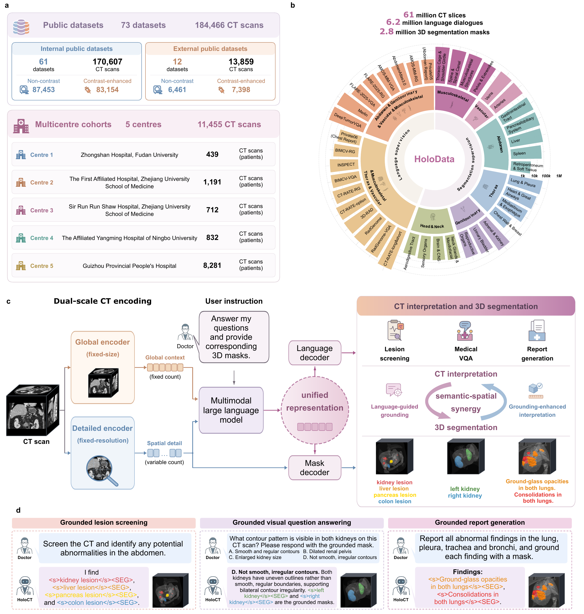

<div align="center">

#  HoloCT

**A 3D foundation model unifying CT interpretation and segmentation**

[](https://huggingface.co/Alibaba-DAMO-Academy/HoloCT-4B)
[](https://huggingface.co/Alibaba-DAMO-Academy/HoloCT-8B)
[](https://arxiv.org/abs/2611.06471)
[](LICENSE)
[](https://www.python.org/)
[](https://huggingface.co/docs/transformers)

[Overview](#overview) · [Models](#models) · [Installation](#installation) · [Demos](#demos) · [Evaluation](#evaluation) · [Citation](#citation)

</div>

## Overview

**Paper:** [A 3D foundation model unifying CT interpretation and segmentation](https://arxiv.org/abs/2611.06471) (arXiv:2611.06471).

**HoloCT** brings CT interpretation and voxel-level segmentation into one model. Given a **3D CT volume and a text prompt**, it performs lesion screening, visual question answering, report generation and segmentation. Grounded responses connect textual findings to **3D masks**.

HoloCT combines whole-volume context from a global encoder with fine-grained spatial features from a detailed encoder, a Qwen3-VL language backbone and a 3D mask decoder. **HoloCT-4B** and **HoloCT-8B** share the same task interfaces.

<p align="center">
  
</p>
<p align="center"><sub>HoloDATA and HoloCT: CT data and annotations, dual-scale encoding, and text responses linked to volumetric masks.</sub></p>

<details>
<summary><strong>📘 Abstract</strong></summary>

Radiologists interpret computed tomography (CT) scans by jointly determining what a finding represents and where it lies in three-dimensional (3D) anatomy. However, deep learning models for CT have largely treated CT interpretation and 3D segmentation as separate tasks, leaving textual findings spatially unverifiable and overlooking potential synergy between clinical understanding and spatial perception. Here we present HoloCT, a generalist 3D foundation model unifying CT interpretation and voxel-level segmentation by jointly modelling whole-volume context and fine-grained anatomical detail, performing diverse clinical tasks while providing 3D masks as evidence. To develop and evaluate HoloCT at scale, we curated HoloDATA, comprising 195,921 CT scans from 73 public datasets and six clinical cohorts, with 6.2 million instruction dialogues and 2.8 million CT–mask pairs. Across 346 tasks spanning segmentation, lesion screening, visual question answering, and report generation on 61 internal and 12 external datasets, HoloCT outperformed both specialist and foundation models. In multicentre validation across 11,455 clinical CT scans from five hospitals, HoloCT outperformed competing models in lesion segmentation and report generation by 18.2 and 15.3 points. It also achieved 85.1% mean accuracy in screening thyroid tumours and colon lesions, exceeding all four participating radiologists in a retrospective reader study. Further analyses revealed bidirectional semantic–spatial synergy: language-guided segmentation delineated unseen anatomical structures and lesions as well as diffuse free-text findings, outperforming the leading approach by 22.1 points, whereas prompting the model to generate corresponding 3D masks alongside its textual outputs significantly improved interpretation performance. In summary, HoloCT shows that clinical understanding and spatial perception can be learned together within a single foundation model and offers a path towards more accurate and reliable CT analysis.

</details>

### Key capabilities

- **Unified CT tasks:** lesion screening, VQA, report generation and segmentation through text prompts.
- **Spatial grounding:** associate generated findings with voxel-level masks.
- **Language-guided segmentation:** delineate anatomical targets or findings described in free text.
- **Paired demos:** compare grounded and ungrounded responses on the same CT.

## Models

| Model | Language backbone | Checkpoint |
|---|---|---|
| **HoloCT-4B** | Qwen3-VL-4B | [Alibaba-DAMO-Academy/HoloCT-4B](https://huggingface.co/Alibaba-DAMO-Academy/HoloCT-4B) |
| **HoloCT-8B** | Qwen3-VL-8B | [Alibaba-DAMO-Academy/HoloCT-8B](https://huggingface.co/Alibaba-DAMO-Academy/HoloCT-8B) |

After [installation](#installation), download either complete checkpoint, including its tokenizer and processor files:

```bash
python -c "from huggingface_hub import snapshot_download; snapshot_download('Alibaba-DAMO-Academy/HoloCT-4B', local_dir='weights/HoloCT-4B')"

python -c "from huggingface_hub import snapshot_download; snapshot_download('Alibaba-DAMO-Academy/HoloCT-8B', local_dir='weights/HoloCT-8B')"
```

The demos use `weights/HoloCT-4B` by default. Select the 8B model with `--model weights/HoloCT-8B`.

## Installation

Use **Ubuntu 22.04**, **Python 3.10.16** and an NVIDIA GPU supporting **bfloat16**. Each demo runs on one visible GPU with PyTorch SDPA. Run the commands from the repository root.

```bash
git clone https://github.com/alibaba-damo-academy/HoloCT.git
cd HoloCT

conda env create -f environment.yml
conda activate holoct
python -m pip install torch==2.6.0 torchvision==0.21.0 --index-url https://download.pytorch.org/whl/cu124
python -m pip install -r requirements.txt
```

## Demos

### Prepare a CT

Use a 3D NIfTI volume (`.nii` or `.nii.gz`) in Hounsfield units. The six demo scripts use task-named CT files in `demo_ct/` and prompts defined in their scripts.

| Task | Default CT | Demo module |
|---|---|---|
| Lesion screening | `demo_ct/lesion_screening.nii.gz` | `inference.scripts.demo_lesion_screening` |
| Visual question answering | `demo_ct/vqa.nii.gz` | `inference.scripts.demo_vqa` |
| Anatomy-grounded reporting (RadGenome) | `demo_ct/radgenome_rg.nii.gz` | `inference.scripts.demo_radgenome_rg` |
| Finding-grounded reporting (ReXGrounding) | `demo_ct/rexgrounding_rg.nii.gz` | `inference.scripts.demo_rexgrounding_rg` |
| Target segmentation | `demo_ct/seg.nii.gz` | `inference.scripts.demo_seg` |
| Finding-level referring segmentation | `demo_ct/rex_seg.nii.gz` | `inference.scripts.demo_rex_seg` |

### Run a demo

```bash
CUDA_VISIBLE_DEVICES=0 python -m inference.scripts.demo_lesion_screening
CUDA_VISIBLE_DEVICES=0 python -m inference.scripts.demo_vqa
CUDA_VISIBLE_DEVICES=0 python -m inference.scripts.demo_radgenome_rg
CUDA_VISIBLE_DEVICES=0 python -m inference.scripts.demo_rexgrounding_rg
CUDA_VISIBLE_DEVICES=0 python -m inference.scripts.demo_seg
CUDA_VISIBLE_DEVICES=0 python -m inference.scripts.demo_rex_seg
```

The first four demos run **ungrounded and grounded prompts on the same CT**. The final two run segmentation prompts.

### Use your own CT and prompt

Segment a target with HoloCT-4B:

```bash
CUDA_VISIBLE_DEVICES=0 python -m inference.scripts.demo_seg \
  --model weights/HoloCT-4B \
  --ct demo_ct/my_ct.nii.gz \
  --prompt "Segment the liver in this CT scan." \
  --output outputs/my_seg
```

Compare text-only and grounded answers with HoloCT-8B:

```bash
CUDA_VISIBLE_DEVICES=0 python -m inference.scripts.demo_vqa \
  --model weights/HoloCT-8B \
  --ct demo_ct/my_ct.nii.gz \
  --prompt "Is there a liver lesion?" \
  --grounded-prompt "Is there a liver lesion? Ground your answer with the mask." \
  --output outputs/my_vqa
```

For paired demos, specify both prompts when changing the question. Changing `--ct` alone keeps the example prompts. Choose a new output directory for each run.

### Outputs

Each demo saves its results under `outputs/<task>/`. The `grounded/` and, for paired tasks, `ungrounded/` directories contain:

| File | Contents |
|---|---|
| `response.txt` | Generated text |
| `response_raw.txt` | Generated text with grounding tokens |
| `result.json` | Prompt, response and mask-to-label mapping |
| `mask_000.nii.gz`, … | A binary 3D mask for each generated `<SEG>` token |

The task-level `result.json` records the CT filename, generation settings and responses. View the masks alongside the input CT in a NIfTI viewer. Responses without a generated `<SEG>` token contain text without mask files.

### Inference settings

All six demos use **1024 maximum new tokens** and seed **42**. Screening, VQA and segmentation use greedy decoding. Reporting uses sampling with temperature **0.15**, top-p **0.85** and repetition penalty **1.15**. Paired runs use the same seed for each prompt.

The detailed branch uses foreground cropping, adaptive spacing with a 1.5 mm base and padding to multiples of 32. The global branch resizes to 128 × 256 × 256. Both branches clip HU to [−1000, 1000] and scale to [0, 1]. Masks are thresholded at 0.5 after inverse transformation.

## Evaluation

The [single-sample evaluation examples](eval/README.md) compute metrics from one prediction and its corresponding reference.

| Output | Metrics |
|---|---|
| Segmentation | Dice, HD95 and finding-level HIT indicators |
| Lesion screening | Target-level TP, TN, FP or FN |
| VQA and reports | BLEU-4, ROUGE-L, METEOR, Llama clinical score, GREEN and RaTEScore |
| Grounded reports | Finding matching, finding F1, conditional Dice and FL-GRQ |

For example, compute mask metrics for one target:

```bash
python -m pip install -r requirements-eval.txt
python -m eval.seg_and_screening \
  --prediction outputs/my_seg/grounded/mask_000.nii.gz \
  --reference data/reference_mask.nii.gz
```

## Project structure

```text
models/                 HoloCT model, processors and encoder/decoder modules
utils/                  Preprocessing, label dictionaries and prompt templates
inference/dataset/      CT dataset and collator
inference/scripts/      Six inference demos
inference/demo_utils.py Model loading, generation and mask export
eval/                   Single-sample metric examples
demo_ct/                Task-named CT inputs
```

## Citation

If you use HoloCT, please cite our [arXiv preprint](https://arxiv.org/abs/2611.06471):

```bibtex
@misc{xie2026holoct,
  title={A 3D foundation model unifying CT interpretation and segmentation},
  author={Xie, Yulu and Li, Zilong and Xu, Shen and Bai, Yifan and Shi, Liuhong and Chen, Jiao and Kong, Xianglei and Zhu, Wenchao and Shen, Na and Ye, Xianghua and Yan, Yang and Zheng, Jiaju and Peng, Yunsong and Su, Yanzhou and Yu, Chaohui and Luo, Hao and Wang, Fan},
  year={2026},
  eprint={2611.06471},
  archivePrefix={arXiv},
  url={https://arxiv.org/abs/2611.06471}
}
```

## Acknowledgements and license

HoloCT builds on [Qwen3-VL](https://github.com/QwenLM/Qwen3-VL), [Med3DVLM](https://github.com/mirthAI/Med3DVLM) and [MONAI VISTA](https://github.com/Project-MONAI/VISTA).

HoloCT code and model weights are released under the **MIT license**. See [LICENSE](LICENSE) and [third-party notices](THIRD_PARTY_NOTICES.md) for component attributions and licenses.
